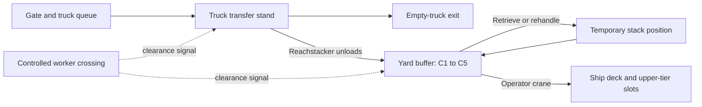

# PortLab: operational container-terminal upgrade

**Professor review proposal · 4 November 2026**  
**Implementation update:** iteration 3 adds moving workers, separated/controlled/intrusion traffic policies, road-truck and trolley crossing interlocks, physical obstacles and spreader contacts, near-clearance/contact episodes, effects/audio, protected holds and explicit recovery, a port overview and op3 incident/delay records. The five-container layouts, rehandle/stacking and full intake remain. See `OPERATIONAL_ITERATION_3.md`, `VERIFICATION.md` and `UPGRADE_STATUS.md`. Final participant-study/ratings work and actual headset performance still remain. Earlier scenes/players are preserved.

## 1. Project purpose and proposed outcome

**Research question:** How do container staging, stacking order and traffic organisation affect handling time, unnecessary moves, delays, collisions and operator workload?

The next version will represent a small, functioning terminal cell. Trucks deliver five identifiable containers. A handling machine unloads them into a configured yard arrangement. The crane operator retrieves the required containers, clears stacks and obstacles, responds to workers/traffic, and loads designated positions on a moored ship. The shipment ends when all five containers are correctly stowed and the crane is parked.

This provides more than a visually busy scene: every foreground vehicle, worker, stack and receiving position has an operational role and a measurable effect. Maya provides the next instruction inside the simulator.

**Proposed demonstration:** truck arrival → visible machine-assisted unloading → yard stack → one blocked-container retrieval → worker-crossing stop → ship loading at two heights → results showing handling, rehandling, waiting and incidents.

## 2. What exists, and what needs to change

The repository was inspected before preparing this proposal.

| Area | Verified v6 baseline | Proposed operational version |
|---|---|---|
| Task | Three sequential cargo deliveries; A/B receiving layouts and C stacked pickup | Four-container practice and five-container shipments; multiple moves may involve the same container |
| Port activity | Animated ocean/tug; 40 decorative freight containers | Delivery trucks, unloading machine, walking workers and a neighbouring working crane |
| Ship | Background scenery | Reachable moored vessel with collidable deck, receiving slots and tiered cargo |
| Crane | Slewing boom, radial trolley and hoist; seated view and detailed visual rig | A coherent quay-crane layout with actual reach to the transfer stand, buffer and vessel |
| Stacking | A three-high source stack; ground-level destinations | Place onto a stack, remove only accessible top cargo, rehandle blockers, and stack on the ship |
| Acceptance | Matching released, aligned, still cargo near a fixed deck height | Support-relative acceptance on ground, trailer, container top or ship deck |
| Cargo lifecycle | `IsPlaced` ends that cargo's task; only the assigned active load can be coupled | Persistent cargo identities, repeat handling, support relationships and move-specific completion |
| Collision | Active-load impact count above a speed threshold | Contact classification, near-miss tracking, local feedback and an incident/recovery workflow |
| Measurement | Four phase times, travel, impacts, ratings and CSV | Shipment time, move times, rehandles, vehicle/worker waits, response times and detailed incident records |

Important implementation findings:

- Updating the three labels to five is insufficient. Completion rules, guide text, smoke tests and task selection contain three-job assumptions.
- `TargetArea` currently validates against a ground reference. Elevated stacks and ship placements require actual support-surface validation.
- The four visible hoist cables share the existing single-rope physics. Their appearance does not establish a four-rope mechanical simulation.
- Decorative freight and the moving tug deliberately have no colliders. Foreground obstacles need new collision and interaction rules.
- The old impact-sound path in `Load.cs` depends on `AudioManagerVR`, which the guided builder removes. A dedicated collision-audio service is needed.
- The present source/training scale must be reconciled with trucks, people and the vessel. Reach, clearance and scale must be designed together.

## 3. A sensible terminal layout

Use one compact operating area with distinct zones:

| Zone | Function |
|---|---|
| Gate and one-way road | Loaded truck entry, short queue and empty-truck exit |
| Marked transfer stand | Truck stops, brakes and receives unloading permission |
| Handling-machine route | Reachstacker travels between trailer and buffer slots |
| Yard buffer | Five active containers, accessible stack positions and one temporary rehandle position |
| Pedestrian route | Protected walking area and a controlled crossing with stop/go signals |
| Crane apron | Operator's reachable working envelope, clearances and final parking position |
| Berth and ship | Mooring/fenders, vessel deck, numbered slots and upper-tier receiving positions |
| Neighbouring berth | One additional crane doing a simplified loading cycle; further cranes can provide distant context |

**Recommended crane direction:** build a recognisable ship-to-shore gantry for the operational scene. Its trolley travels between the landside transfer area and ship; the hoist raises/lowers the load. Limited berth positioning can be added, while a rotator aligns the spreader. Keep the existing slewing-crane scene available for the earlier experiment rather than silently changing its controls and data interpretation. A true mobile-harbour-crane alternative would require a coherent luffing/slewing model, not simply a new label on the existing trolley crane.

Before modelling detail, prove every pickup and destination lies inside the crane's working envelope, including the highest stack, the ship's sides and the lowest receiving surface. Position or rebuild the berth accordingly. Do not move an arbitrary ship mesh closer and assume the cargo is reachable.

Keep the ship moored during handling. Its operational change is visible cargo accumulation, occupied deck slots and loading status. Vessel bobbing would complicate support physics and confound placement comparisons, so it is excluded initially. A departure/tug sequence after shipment completion can be an optional presentation feature.

This design distinguishes quayside handling from yard stacking, as illustrated by the equipment roles in [Liebherr's container transport and stacking overview](https://www.liebherr.com/en-ca/maritime-cranes/products/port-equipment/areas-of-application-in-ports/stacking-4674146) and [Konecranes' ship-to-shore crane overview](https://www.konecranes.com/sites/default/files/download/shiptoshoregantrycrane.pdf). It is a compact educational terminal, not a complete commercial-terminal digital twin.

## 4. The complete truck–yard–ship workflow

### Default shipment: intake by NPC machine, export by the student

1. **Briefing.** Maya introduces the shipment, container IDs, layout and vessel loading order. The operator calibrates the seated view and practices the controls.
2. **Arrival.** A tractor-trailer enters with one visible container. Five deliveries use five visits; a single reusable vehicle model can represent the visits.
3. **Truck positioning.** The truck queues if necessary, stops in the marked stand, applies its brake and changes the transfer signal. Unloading cannot begin while it moves.
4. **Visible unloading.** A reachstacker approaches, aligns its spreader, acquires the container, lifts it clear of the trailer, drives to the buffer and lowers it onto its configured support. Cargo remains visible throughout the handoff. The empty truck leaves after clearance.
5. **Operator handoff.** The manifest updates only after the container is supported and released. Maya identifies the next export job. The scenario can finish intake before operator work, or overlap arrivals in a separate busy-port mode.
6. **Retrieval.** The operator selects an accessible top container. If the required cargo is buried, its blocker must first move to the marked temporary position.
7. **Lift and transfer.** Raise above the actual stack/route clearance, control sway, align orientation, observe signals and move toward the vessel. Low obstacles can be cleared by hoisting; a worker entering a restricted area requires a stop and clearance rather than simply lifting over the worker.
8. **Ship placement.** Lower into the nominated deck or upper-tier slot. Completion requires the correct cargo, valid support, alignment, release and stable settling.
9. **Next operation.** Reposition the empty spreader toward the next pickup. The fixed HOME trip is removed from the new operational workflow; final parking occurs once at the end. The original v6 HOME-based experiment remains reproducible.
10. **Debrief.** Show five containers shipped, number of crane moves, rehandles, delays, contacts/near misses and element times. Collect post-run workload/discomfort ratings and export the records.

A normal road trailer does not unload itself. Giving the unloading action to a reachstacker makes the requested handoff visible and mechanically understandable. Connections between trucks, yard handling and vessel operations are also described in the [Valenciaport container-terminal capacity manual](https://www.fundacion.valenciaport.com/wp-content/uploads/2020/06/Capacity_EN-1.pdf).

### Additional operating modes

- **Receive and stack:** the student unloads trailers and builds the specified yard arrangement before exporting. Five receipts plus five ship loads produce at least ten crane moves.
- **Free stacking practice:** pick any accessible training container and place it into an adjacent slot or on a supported stack, initially limited to three tiers. Guidance explains unsupported, rotated, occupied or blocked placements.
- **Priority retrieval:** retrieve a named lower container, temporarily relocate the blocker and finish the shipment without losing track of cargo.
- **Busy berth:** overlap truck arrival, a controlled worker crossing and cargo handling. Waiting and response become part of the task.
- **Reverse ship unloading:** ship → transfer vehicle/yard as a later extension, after the export workflow passes its tests.

Use the default shipment for the main demonstration. The extra modes reuse the same cargo, support and task systems rather than becoming unrelated minigames.

## 5. Five active containers and configurable layouts

Use persistent C1–C5 identities, numbers plus colours, and the same cargo dimensions/mass settings within a comparison. Four-container practice is a scenario setting, not a separate hardcoded implementation. Agree a common 20-foot-style scale for the new scene and retune geometry/physics together; preserve the smaller v6 scene separately.

| Preset | Initial yard arrangement | Required work | Educational purpose |
|---|---|---|---|
| A — accessible staging | Five ground-level sources in marked positions | Five direct ship deliveries | Baseline travel, positioning and placement |
| B — compact stacking | One three-high stack: C1 above C2 above C3; one two-high stack: C4 above C5 | Top-down retrieval in compatible order; five deliveries | Vertical travel, stack clearance and space utilisation |
| C — priority retrieval | Stack 1: C2 above C5; stack 2: C1 above C4; C3 separate; one empty temporary slot | Ship order C5, C1, C3, C2, C4; move C2 aside first | Planning and unnecessary handling: five deliveries plus one necessary rehandle |

Ship destinations include three lower slots and two upper-tier slots. Upper placements become available only after their lower support containers are accepted. Preset C's destination assignments must follow its manifest, so it is a separate method challenge, not an isolated height-only experiment.

Each preset stores positions, yaw, tiers, support IDs, loading order, temporary capacity and arrival settings. Calm/busy traffic and worker-event settings are separate switches. Do not bundle a harder layout, more pedestrians and a different crane speed into one comparison and attribute the result to layout alone.

**Core stacking rules:**

- One slot cannot contain two containers; placement must have sufficient footprint support and compatible alignment.
- A lower container cannot be lifted while another remains supported on it. The simulator explains which container blocks it.
- Stable placement completes a move, not the container's entire lifetime. The same C2 can be rehandled and subsequently shipped.
- Containers retain physical motion while lifting/settling. Any placement assistance is consistent, declared, logged and switchable; no long-distance snapping or hidden teleportation in measured handling.
- Accidental stacking, unsupported release and cargo outside the working area have explicit recovery instructions and preserve partial data.

## 6. People, vehicles and obstacles with operational roles

**Initial active cast:** one truck in the foreground, one reachstacker, one banksman and two walking workers. One neighbouring crane performs a simplified visible handling cycle. Add a second traffic vehicle only after performance and route coordination are stable.

Workers need recognisable walk, idle, stop, look and signalling animation—not static figures sliding across the ground. Use licensed rigged characters/animations, high-visibility clothing and helmets. Maya remains the instructor; the banksman provides local clearance signals.

The default scene has separated pedestrian and vehicle routes. A worker can approach a controlled crossing, wait, cross, then clear the route. An explicitly selected hazard exercise introduces an abnormal restricted-zone intrusion; it is not the normal operating rule. These choices follow the general design principles discussed by [HSE for transport in ports](https://www.hse.gov.uk/ports/transport.htm) and [pedestrian/vehicle separation](https://www.hse.gov.uk/workplacetransport/separating.htm). These are design references, not a claim of local regulatory compliance.

Foreground obstacles include parked trailers, container stacks, barriers, crane legs, ship rails/superstructure and a restricted crossing. All have meaningful collision shapes. Decorative distant props remain lightweight scenery.

Actors follow repeatable routes and obey occupancy/permission signals. Vehicles stop before blocked transfer stands and crossings. Use seeded schedules or operation-triggered events for comparable trials; avoid uncontrolled random pedestrians that make one participant's task much harder than another's. Log actual event times and any route variations.

## 7. Collision effects, warnings and recovery

| Situation | Visible/audible response | Operational consequence and data |
|---|---|---|
| Normal gentle landing | Soft metal seating sound; settling/lock indicator | Accepted support contact; no collision penalty |
| Light scrape or bump | Contact-local scrape/clank, brief outline, small material-appropriate dust/paint effect | Log objects, location, speed and duration; let operator correct |
| Strong cargo/structure impact | Stronger sound, warning light, caption and controller pulse where supported | Record severity proxy; require recovery/inspection acknowledgement |
| Near miss | Clearance indicator and directional warning | Log minimum clearance and episode duration, distinct from actual contact |
| Person contact or restricted-zone incident | Protected stop, warning beacon and Maya's recovery instruction | Stop operation and retain the partial record; resume/reset through an explicit procedure |
| Wrong/unsupported release | Failed-placement explanation and highlighted correction | No delivery credit; reattach/recover where possible |

Detect contacts for the spreader, cargo and relevant actors, not only the active load. Low-speed sustained intrusion can matter even when an impact-speed threshold is not exceeded. Classify intended support contact separately, deduplicate one scrape across multiple colliders, and end an episode before counting a new incident.

Record relative velocity, contact category and impulse where available. Treat severity as a simulator-defined proxy; simplified masses and joints cannot justify real injury or structural-damage predictions. Effects originate at the contact point. Avoid explosions, automatic ragdolls or sparks for every gentle touch. Keep headset motion tracked; use sound, indicators and haptics rather than forced VR camera shake.

A stop must retain the cargo safely in the simulator state. Pause/reset must also stop trucks, workers, machinery and audio coherently. A collision is an event with a clear next action, not merely a flash followed by a stuck task.

## 8. Sound, assistance and operator interaction

Spatial audio will distinguish truck acceleration/braking/reversing, reachstacker lift hydraulics, crane hoist/trolley motion, cable/sheave activity, twistlock engage/release, container landing/scrape, radio signals and harbour ambience. Motor intensity follows actual motion. Warning/voice priority prevents several sounds competing; offer captions and independent volume controls.

Maya's instructions become event-based: “Truck is positioning,” “Wait for clearance,” “C5 is blocked by C2,” “Raise above the stack,” “Load ship slot 2, upper tier,” and “Contact detected—stop and inspect.” New offline speech clips accompany the expanded workflow; captions and a compact manifest always show the next action and current wait reason.

For the new gantry crane, expose labelled trolley, hoist, limited berth-positioning and spreader-rotation controls, plus precision and emergency stop. Show the mapping in the cabin and tutorial. Pilot it on desktop first and verify both tracked controllers in the lab. The old scene retains its familiar slew/trolley mapping.

## 9. Work System Design and Ergonomics experiments

| Course topic | Proposed exercise and evidence |
|---|---|
| Direct time study | Align/acquire, lift clear, transfer, lower/align, release/verify and empty reposition; record exclusive element times |
| Method/layout study | Compare accessible vs stacked staging, report total shipment time, vertical/horizontal travel, space use and errors |
| Process analysis | Truck queue → unloading → yard wait → crane handling → vessel; identify waiting, transport and rehandling |
| Work sampling | Observe predefined activity categories at random scheduled instants across runs; report sample size and uncertainty |
| Normal/standard time | Apply a declared performance rating only to the manually paced portion; identify machine-paced and waiting portions separately and state allowance convention |
| PMTS/MTS | Annotate the operator's reach/select/control actions using the course's chosen method and tables; compare with observed actions without inventing motion-time values |
| Reaction time | Timestamp a controlled warning and the operator's stop/acknowledgement response; keep warning type and trigger rule fixed |
| Hick's law | Optional separate choice-response exercise with controlled numbers of signal choices; avoid treating a complex shipment-time difference as a Hick's-law test |
| Index of difficulty / control optimisation | Separate controlled target-alignment or control-panel selection task with recorded distance/target size; do not fit a pointing model blindly to coupled crane motion |
| Workload / discomfort | Consistent before/after ratings, exposure duration, errors and command usage; identify custom ratings as self-report, not physiological fatigue measurement |

**Recommended main experiment:** five-container A/B comparison with the same ship destinations/order, speeds, cargo properties, view policy, guidance, traffic schedule and placement assistance. Balance condition order, train participants first and analyse within-participant differences. Stacking changes height and spatial arrangement together; record the actual geometry and avoid claiming an isolated cause that the design does not control.

Use priority-retrieval C to study rehandles/planning. Compare traffic separation or traffic intensity in a second experiment while holding the cargo layout fixed. Do not run a large factorial study unless the participant/time budget supports it. A single professor demonstration establishes function, not a general ergonomic advantage.

**Timing definitions:** keep end-to-end shipment time, operator-period time, per-move element time, command-active time and waiting breakdown distinct. A delay can be tagged to its cause without adding that duration twice to the total. Software pause is excluded; required operational waiting is included in the relevant shipment/operator totals. Report five containers shipped alongside all moves, so an inefficient six-move solution cannot appear faster by averaging only selected moves.

## 10. Implementation architecture and data

Create `Assets/Scenes/OperationalPort.unity` and a separate operational feature folder. Preserve `SeaportResearch.unity`, v6 data and its existing analysis path.

| Proposed module | Responsibility |
|---|---|
| `PortScenarioConfig` | Cargo count/manifest, layout, support graph, arrivals, hazards, seed and assistance settings |
| `PortScenarioDirector` | Arrival, intake, handoff, operator work, incidents and shipment completion |
| `ContainerEntity` + `CargoSlot` | Persistent identity, location, tier, support and blocked/unblocked status |
| `HandlingTaskGraph` | Delivery dependencies, temporary moves, permitted next operations and recovery |
| `PortCraneController` + rig adapter | Coherent gantry movement, limits, rotator, spreader and motion feedback |
| `TruckAgent` / `ReachstackerAgent` | Route permissions, stop/brake/load states and visible cargo handoff |
| `WorkerAgent` / `CrossingController` | Animation, route movement, crossing permissions and hazard events |
| `ContactMonitor` / `IncidentController` | Contacts, clearance episodes, protected stop and recovery |
| `PortAudio` / Maya guide | Prioritised spatial sound, captions and context instructions |
| `OperationalRunRecorder` | Versioned shipment/move/events/ratings/setup exports |

Use one authoritative owner for each container at a time: truck → handling machine → supported yard slot → player crane → supported vessel slot. Coordinate parenting/kinematic states and rigidbody velocities at handoff. No duplicate cargo copies, disappearing loads or animation/physics systems fighting over the same transform.

Use deterministic waypoint routes for the small initial actor set. Introduce navigation/path-planning dependencies only if the authored routes require them. Keep current Unity/OpenXR/XRI versions unless a specific compatibility issue requires a change.

**New data schema:** `runs.csv` for scenario/version/seed and clocks; `moves.csv` with a unique move ID, repeated container ID, operation, source/destination support/tier and element times; `events.csv` for arrivals, signals, waits, contacts and recovery; `ratings.csv`; optional `samples.csv`; and `scenario.json` containing geometry, physics, actor timing and thresholds. Events identify actor roles and current cargo ownership so NPC-only incidents are not silently counted as operator impacts. Version the schema explicitly and add an operational analysis tool; do not silently mix these records with v6's three-delivery records.

## 11. Delivery sequence, estimates and acceptance gates

These are planning estimates, not a fixed completion promise. They assume usable licensed assets, the current editor working, and access to a lab testing slot. Detailed vehicle/character art or hardware issues can extend them.

| Milestone | Deliverable | Focused effort estimate | Gate before proceeding |
|---|---|---|---|
| 1 — reachable terminal | Common scale, quay/ship geometry, support slots, crane envelope | 3–5 h | Every pickup/tier/ship slot is physically reachable |
| 2 — one complete chain | One truck, visible unloading machine, one yard-to-ship job | 4–7 h | No teleport/ownership error; full chain completes and resets |
| 3 — five-box work | Configurable counts, stack building/removal, retrieval/rehandle, tiered ship placement | 4–7 h | Five cargo identities conserved; correct 5/6/10-move workflows complete |
| 4 — people and obstacles | Workers, crossing, traffic gating, contacts/near misses and protected stop | 4–7 h | Actor conflicts and collision recovery behave consistently |
| 5 — operational guidance | Audio, Maya, manifest, time breakdown and versioned exports | 3–5 h | Each state has an instruction and reconstructible data |
| 6 — release validation | Repeated resets, failures, desktop/VR performance and build | 4–8 h | Acceptance suite and actual headset/controller pilot pass |

**Core estimate: roughly 22–39 focused development hours, about 3–5 full working days.** More polished character/vehicle animation and additional background operations should have a further allowance. Confirm the available deadline before implementation scheduling.

If only one day is available, deliver a clearly labelled first slice: a visible truck intake, reachable ship, five-container task list, one controlled worker event and contact sound/warning. Keep the existing crane adapter temporarily. Do not present that slice as completion of the whole operational-terminal plan.

**Minimum acceptance suite:**

1. Repeat a complete five-container shipment and reset without duplicate, lost or incorrectly parented cargo.
2. Validate empty/four/five-container scenario configuration; reject impossible manifests, unsupported tiers and unreachable targets before play.
3. Confirm stacked pickup cannot remove the lower box, top cargo becomes available after a blocker moves, and temporary-slot capacity prevents deadlock.
4. Confirm deck, trailer and upper-tier placements require the correct support and stable release; wrong cargo/slot/orientation is explained.
5. Verify a parked truck stays parked during handling and a queued vehicle cannot enter an occupied transfer stand.
6. Verify pedestrian clearance, a near miss, light contact, strong contact and a protected-stop recovery. Normal landing must not count as an incident.
7. Pause, reset and close during each workflow stage; preserve partial data and restore all actors, cargo ownership, clocks and sounds.
8. Reconcile phase/wait totals against the run clock and an independent pilot recording; ensure repeated container moves retain unique move IDs.
9. Test all layouts and the free-stacking mode on desktop, then the actual lab headset/controllers. Profile CPU/GPU frame times at the selected headset refresh rate; limit active actors, use simple colliders/LOD/instancing and pool effects as needed.

## 12. Deliverables for the professor

- A working operational scene and portable Unity project, with the original baseline preserved.
- A short guided demonstration of intake, blocked retrieval, vertical clearance, worker response and ship stacking.
- Three scenario definitions, a five-container manifest and an annotated terminal layout.
- A task/process chart showing handling, waiting and rehandling.
- Raw versioned logs, metric definitions and analysis scripts; actual participant results only after data collection.
- A reproducible experiment protocol, asset/source attribution and a clear statement of tested hardware and remaining limitations.

**Proposed presentation statement:**

> We are extending the crane prototype into an operational container-terminal simulator. The student will manage a five-container shipment through truck intake, yard storage and vessel loading, including stacking, blocked retrieval, traffic and worker-clearance decisions. We will use its event logs to compare handling methods through time study, movement, rehandling, waiting, errors and self-reported workload. The purpose is to evaluate the work system as well as operate the crane.

The result should demonstrate operational realism and measurable decisions. Photorealistic art, full vessel dynamics, independent four-rope mechanics, multiplayer and industrial certification remain outside the initial release.
